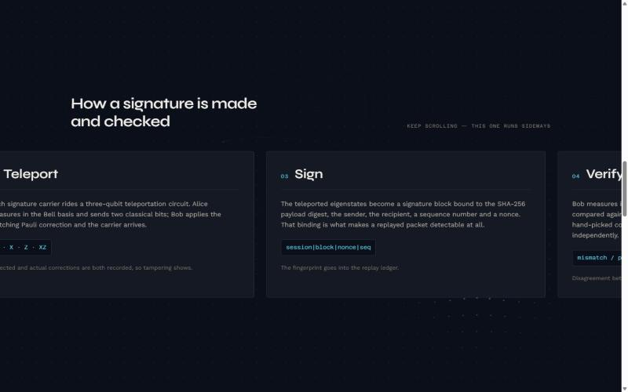
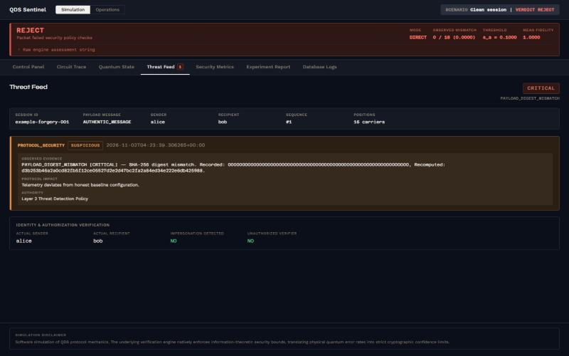
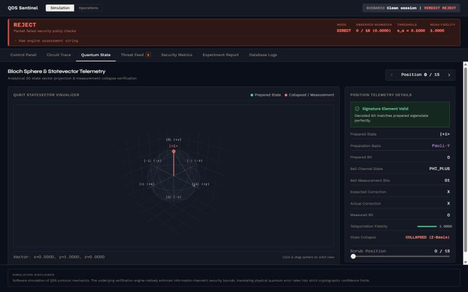
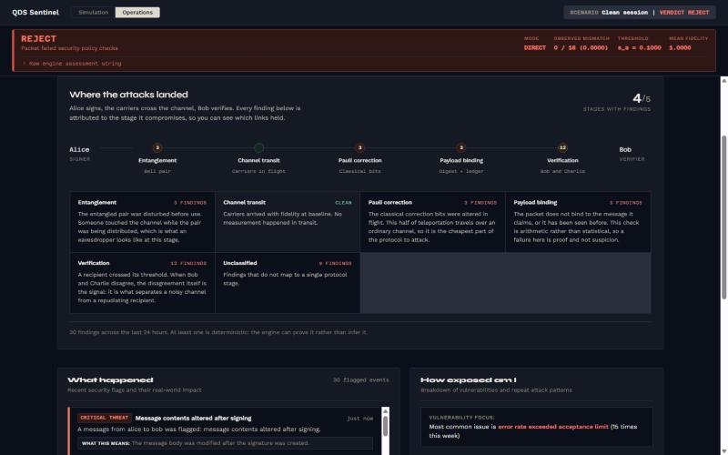

# QDS Sentinel

**QDS Sentinel** simulates teleportation-based Quantum Digital Signatures (QDS) and detects forgery, replay, impersonation and quantum-channel tampering using quantum measurement statistics and deterministic mathematical rules.

A forger cannot copy a quantum state without disturbing it. QDS Sentinel models the protocol end to end, measures that disturbance, and decides whether a signature holds — separating what it can prove from what it can only suggest.

> **Simulation only.** No quantum hardware is involved. See [What this does not claim](#what-this-does-not-claim).


---

## Architecture

All three layers are implemented.

| Layer | Name | Responsibility | Will not do |
|---|---|---|---|
| **1** | Protocol simulation | Exact statevector simulation, Bell pairs, 3-qubit teleportation, Pauli corrections, Born-rule measurement, telemetry | Make security decisions |
| **2** | Threat detection | Threshold analysis, replay ledger, attack classification, Bob/Charlie arbitration | Dress a statistical signal as a proof |
| **3** | Console | Circuit trace, Bloch sphere, threat feed, metrics, audit log | Re-implement the engine |

### Layer 1 — protocol simulation

| Capability | Detail |
|---|---|
| Statevectors | NumPy complex arrays, normalisation asserted (‖v‖ ≈ 1.0) |
| Pauli eigenstates | Exact basis states in X, Y and Z |
| Bell states | Φ⁺, Φ⁻, Ψ⁺, Ψ⁻ |
| Teleportation | Full 3-qubit circuit with feedforward correction (I, X, Z, XZ) |
| Measurement | Exact Born-rule probabilities, deterministic or sampled |
| Noise | `NoNoise`, `DepolarizingNoise`, `PauliFlipNoise` |
| Telemetry | Teleportation events, measurement events, position records, mismatch summaries |

### Layer 2 — threat detection

Every detector declares its own authority. Deterministic checks decide; statistical ones only advise.

| Attack | Actor | Indicator | Detector | Authority |
|---|---|---|---|---|
| Intercept and resend | Eve | Mismatch rate above honest baseline | `QBERAnalysisResult` | Statistical |
| Forgery | Third party | SHA-256 digest mismatch | `DigestCheckResult` | Deterministic |
| Replay | Captured traffic | Fingerprint already in ledger | `ReplayDetectionResult` | Deterministic |
| Repudiation | Bob | Bob crosses `s_a` while Charlie stays under `s_v` | `BobCharlieMetrics` | Advisory |
| Partial forgery | Third party | Mismatch scales with guessed fraction | Threshold sweep | Statistical |
| Correction tampering | In-flight | Expected and actual corrections diverge | Correction consistency | Deterministic |
| Channel manipulation | Eve | Per-basis mismatch distribution skews | Basis distribution | Statistical |
| Fidelity degradation | Channel | Mean fidelity below configured floor | Fidelity monitor | Advisory |

### The threshold chain

Four quantities must stay in order. If they cross, the configuration is unsound and the engine raises a `ConfigurationWarning` before judging any packet.

| Symbol | Meaning | Default |
|---|---|---|
| `e_upper` | Honest error ceiling | 0.00 |
| `s_a` | Authentication threshold | 0.10 |
| `s_v` | Verification threshold | 0.20 |
| `p_E` | Best a forger can do | 0.25 |

Required ordering: `e_upper < s_a < s_v < p_E`

---

## Getting started

### Requirements

| Component | Version |
|---|---|
| Python | 3.11+ |
| Node.js | 18+ |

### Backend

```bash
python -m venv .venv
```

```bash
.venv/Scripts/python.exe -m pip install -r backend/requirements.txt
```

```bash
.venv/Scripts/python.exe -m uvicorn app.main:app --app-dir backend --host 127.0.0.1 --port 8000 --reload
```

Swagger UI: `http://127.0.0.1:8000/docs`

### Frontend

```bash
npm install --prefix frontend
```

```bash
npm run dev --prefix frontend
```

| Route | Page |
|---|---|
| `/` | Landing page — what the protocol does and how it is checked |
| `/dashboard` | The console |

The Vite dev server proxies `/api` and `/health` to port 8000, so the backend must be running.

---

## Stack

| Part | Built with | Why |
|---|---|---|
| Simulation | NumPy | Exact complex statevectors; normalisation asserted every step |
| API | FastAPI + Pydantic | Strict request validation and a generated OpenAPI surface |
| Primary store | SQLAlchemy + SQLite | What the dashboard reads; zero setup |
| Audit store | MongoDB + `cryptography` | Append-only, encrypted, hash-chained (see [Audit log](#audit-log)) |
| Console | React 18 + Vite | Seven tabs over one assessment payload |
| Charts | plotly (Bloch sphere), recharts (2D) | 3D state projection vs. ordinary series |
| Motion | GSAP + ScrollTrigger | Landing scroll narrative, dashboard entrance |
| Type | Syne · Work Sans · Azeret Mono | Display, body, and data |

---

## The console

### Landing page — `/`

Explains the protocol before showing any numbers: the three layers, the four
protocol steps (pinned and scrolling sideways, because a protocol is a
sequence), the threshold chain, the eight attacks, and what the project does
not claim. The dot lattice behind it bends toward the cursor — observing the
channel disturbs it, which is the premise the whole system rests on.



### Dashboard — `/dashboard`

Two modes. **Simulation** is the engineer's view, seven tabs over one
assessment:

| Tab | Shows |
|---|---|
| Control Panel | Compose a session: message, parties, signature length, Bell state, bases, seed, attack type, threshold overrides |
| Circuit Trace | Every signature position: basis, prepared state, Bell outcome, expected vs. actual correction, fidelity, match |
| Quantum State | Bloch sphere per position, with prepared state and measurement collapse, and the telemetry behind it |
| Threat Feed | Findings with observed evidence, protocol impact, and which authority raised them |
| Security Metrics | Digest consistency, replay check, thresholds in use, mismatch rate, correction consistency, fidelity monitor |
| Experiment Report | Partial-forgery sweep: mismatch rate against attack intensity, with `s_a` and `s_v` drawn in |
| Database Logs | The stored session as persisted, queried back from SQLite |



*Threat Feed. The evidence is the recorded digest against the recomputed one — the engine shows its working rather than asserting a verdict.*



*Quantum State. Each of the 16 carriers, its prepared eigenstate, where measurement collapsed it, and the fidelity that came out.*

**Operations** is the same data for a non-specialist:

| Panel | Answers |
|---|---|
| Threat status | Is anything wrong right now |
| Where the attacks landed | Which protocol stage each finding compromises, drawn as a pipeline from Alice to Bob |
| What happened | Recent flagged events in plain language |
| How exposed am I | Which vulnerability recurs most |
| Trends | Hourly traffic and incident distribution |



*Where the attacks landed. Every finding attributed to the stage of the protocol it compromises, so the pipeline shows which links held.*

---

## Demo walkthrough

With both servers running, open `/dashboard`. Three buttons in the Control
Panel cover the interesting cases.

| Step | Click | Expect | The point |
|---|---|---|---|
| 1 | **Clean session** | `ACCEPT` · 0/16 mismatch · fidelity 1.0000 | The honest baseline. Everything downstream is measured against this. |
| 2 | **Digest forgery** | `REJECT` · `PAYLOAD_DIGEST_MISMATCH [CRITICAL]` | Recorded and recomputed SHA-256 shown side by side. Arithmetic, not statistics — the engine can prove this one. |
| 3 | **Replay attack** | `REJECT` · `REPLAY_DETECTED` | The fingerprint was already in the ledger. Also deterministic. |
| 4 | Attack type → any, then **Run Assessment** | Varies by intensity | Statistical detectors. The verdict is a threshold judgement, and the engine labels it as such. |

Then switch to **Operations** and read *Where the attacks landed*: the same
findings, attributed to the stage of the protocol each one breaks.

Worth noticing in step 2: the header still reports `0 / 16` mismatch and
fidelity `1.0000` next to a red `REJECT`. That is correct — the rejection came
from the deterministic digest check, not from the statistics — and it is the
clearest illustration of why the two kinds of detector are kept apart.

---

## API

### Layer 1 — `/api/v1/layer1`

| Method | Path | Does |
|---|---|---|
| `POST` | `/simulate` | Run a full QDS protocol session |
| `GET` | `/example-session` | Deterministic 8-position clean session, seed 42 |
| `GET` | `/bloch-state/{basis}/{bit}` | Bloch coordinates for a bare Pauli eigenstate |
| `POST` | `/bloch-trace` | Bloch coordinates for every position in a session |

### Layer 2 — `/api/v1/layer2`

| Method | Path | Does |
|---|---|---|
| `POST` | `/assess` | Simulate and assess, with optional identity checks |
| `POST` | `/assess-existing` | Assess a session without re-running Layer 1 |
| `POST` | `/attack-simulate` | Inject an attack, then assess |
| `GET` | `/example-clean` | Clean session — expect ACCEPT |
| `GET` | `/example-replay` | Replay detection — expect REJECT |
| `GET` | `/example-forgery` | Digest mismatch — expect REJECT |

### Operations — `/api/ops`

| Method | Path | Does |
|---|---|---|
| `GET` | `/overview` | Today's traffic and verdict summary |
| `GET` | `/threat-feed` | Recent flagged events |
| `GET` | `/trends` | Hourly activity and incident distribution |
| `GET` | `/sessions` | Stored sessions |
| `GET` | `/logs` | Telemetry across sessions |
| `GET` | `/logs/{session_id}` | Telemetry for one session |
| `GET` | `/audit/verify` | Whether the Mongo audit chain is intact |

---

## Tests

```bash
.venv/Scripts/python.exe -m pytest backend/tests -q
```

**161 passing.**

| Area | Tests |
|---|---|
| Layer 2 API (integration) | 20 |
| Layer 2 detectors | 19 |
| Layer 2 engine | 16 |
| Replay ledger | 12 |
| Calibration | 11 |
| Layer 1 flow (integration) | 11 |
| Bounds | 10 |
| Bloch visualisation | 10 |
| Teleportation | 6 |
| Quantum states | 6 |
| Pauli corrections | 6 |
| QDS signature | 5 |
| Attacks | 5 |
| Keygen | 4 |
| Measurement | 4 |
| Bell states | 3 |
| Mongo audit sink | 13 |

Five warnings are expected: tests that deliberately feed invalid threshold chains, plus one FastAPI deprecation.

---

## Audit log

Sessions are written to SQLite, which is what the dashboard reads. They are
also mirrored to an append-only MongoDB collection that exists to prove
afterwards that nothing was altered.

Two protections, doing different jobs:

| | Mechanism | Protects against | Reversible |
|---|---|---|---|
| **Confidentiality** | Fernet (AES-128-CBC + HMAC) on `message`, `sender_id`, `recipient_id`, `raw_assessment_string` | Anyone reading the collection directly | Yes — the app decrypts |
| **Integrity** | SHA-256 chain: each record hashes its own content plus the previous record's hash | Silent edits or deletions by anyone with write access | No — one-way by design |

Hashing alone would make the log unreadable, including to the dashboard.
Encryption alone would leave it silently editable. Together the log is
confidential and provably unaltered: changing any record breaks every hash
after it, which `GET /api/ops/audit/verify` reports with the sequence number
where the chain first fails.

Verdicts, rates and thresholds stay in plaintext, so the operations endpoints
can still aggregate over them.

### Configuration

| Variable | Effect |
|---|---|
| `MONGODB_URI` | Enables the sink. Unset, the sink is disabled and the app runs on SQLite alone |
| `MONGODB_DB` | Database name (default `qds_sentinel`) |
| `AUDIT_ENCRYPTION_KEY` | Fernet key or any passphrase. Unset, records are chained but not encrypted |

```bash
export MONGODB_URI="mongodb://localhost:27017"
```

```bash
export AUDIT_ENCRYPTION_KEY="$(python -c 'from cryptography.fernet import Fernet; print(Fernet.generate_key().decode())')"
```

The sink degrades quietly: an unreachable server disables it rather than
failing a request, because losing the audit mirror must never cost the primary
record.

> Tested against `mongomock`, so the suite needs no running server. It has not
> yet been run against a real MongoDB instance.

---

## Layout

```
backend/app/
  layer1_protocol/   statevectors, Bell states, teleportation, signatures
  layer2_threat/     detectors, bounds, calibration, replay ledger, engine
  database/          SQLAlchemy models, CRUD, session, Mongo audit sink
  schemas/           Pydantic request and response models
  api/               Layer 1 and operations routes
frontend/src/
  landing/           landing page, GSAP scroll, cursor-warp canvas
  views/             dashboard tabs
  components/        badges, banners, Bloch sphere, operations mode
  styles/            tokens.css drives the whole palette
docs/                protocol spec, threat model, security claims, audits
```

---

## What this does not claim

Taken from [`docs/layer2-security-claims.md`](docs/layer2-security-claims.md), which is required reading before interpreting any assessment.

| Limitation | Detail |
|---|---|
| No quantum hardware | Every result is a software simulation of protocol mechanics |
| No composable security proof | Approximates Amiri et al. (2016) and Gottesman-Chuang (2001); does not reproduce them |
| Classical digest binding | The quantum key binding that makes real QDS information-theoretically secure is modelled, not proven |
| In-memory replay ledger | Does not survive a restart; distributed replay prevention is out of scope |
| Detection is not exhaustive | Attack variants outside the modelled eight may pass |

---

## Documentation

| Document | Covers |
|---|---|
| [`protocol-spec.md`](docs/protocol-spec.md) | The protocol as implemented |
| [`threat-model.md`](docs/threat-model.md) | Actors, attacks, detectors, limitations |
| [`layer2-security-claims.md`](docs/layer2-security-claims.md) | What is and is not proven |
| [`layer1-assumptions.md`](docs/layer1-assumptions.md) | Layer 1 scope boundaries |
| [`layer1-api.md`](docs/layer1-api.md) · [`layer2-api.md`](docs/layer2-api.md) | Endpoint reference |
| [`layer2-detection-spec.md`](docs/layer2-detection-spec.md) | Detector definitions |
| [`demo-script.md`](docs/demo-script.md) · [`layer3-demo-script.md`](docs/layer3-demo-script.md) | Walkthroughs |
